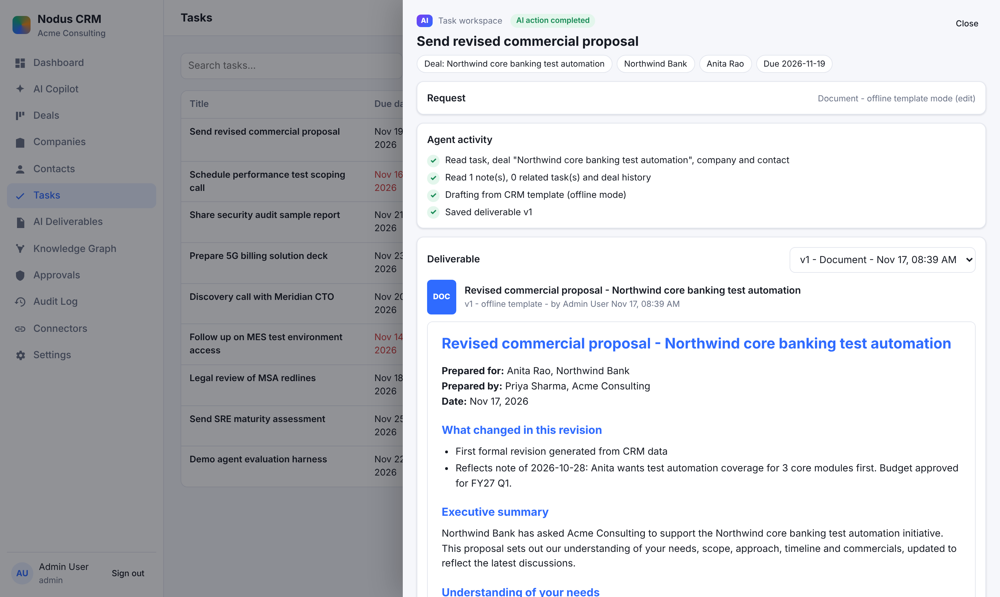
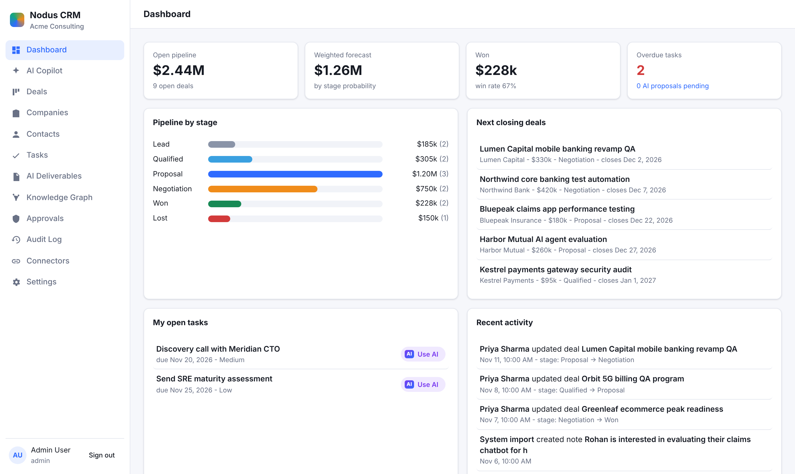
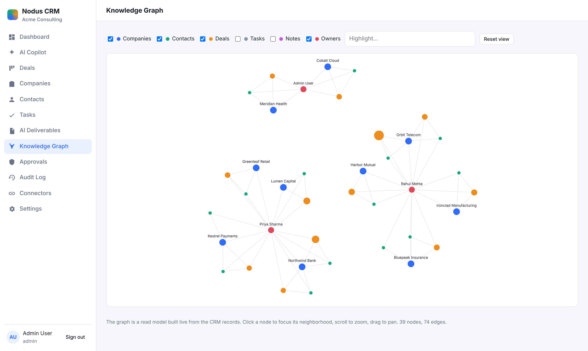
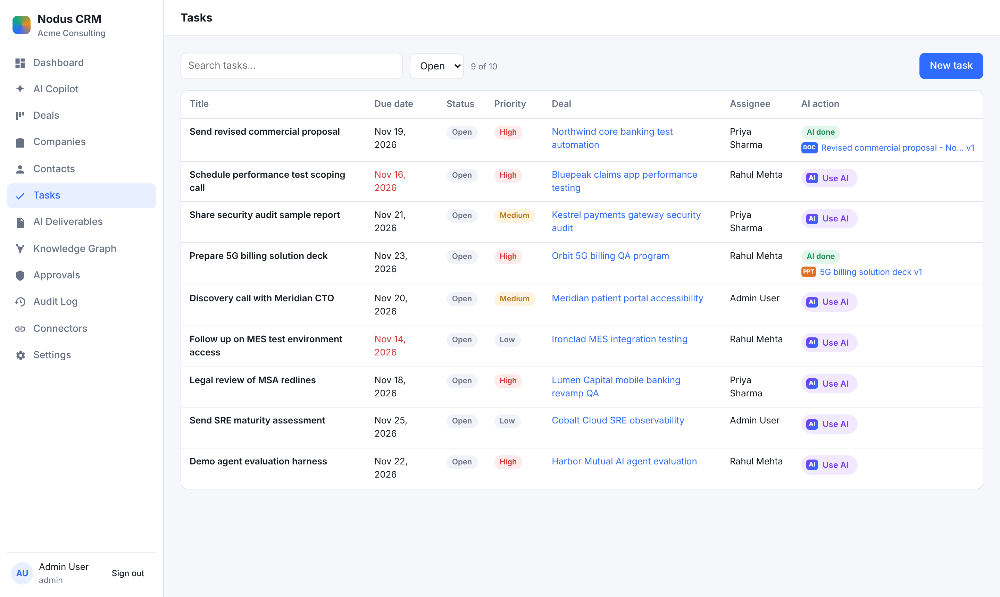
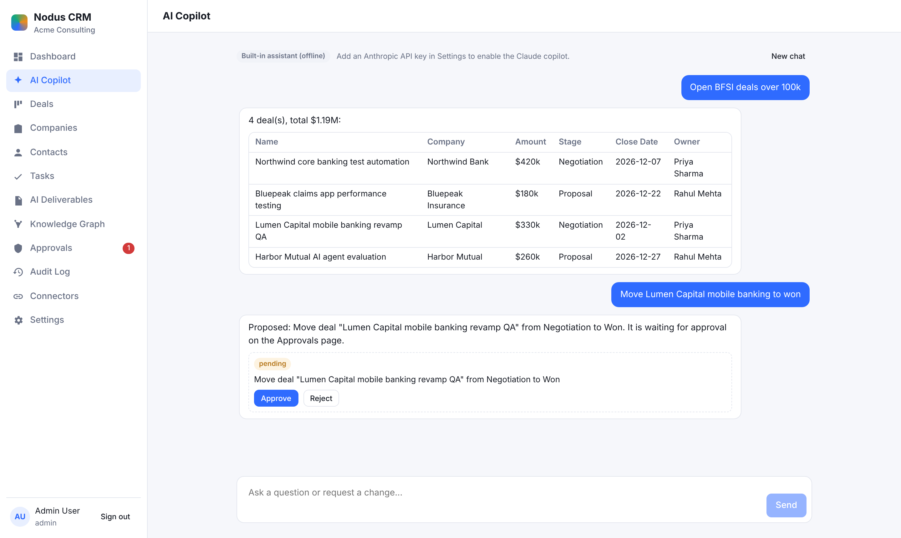

<div align="center">

# Nodus CRM

**The open-source AI CRM where agents do the work.**

A CRM built around a knowledge graph, natural-language queries and AI agents that turn tasks into finished deliverables (proposals, emails, slide decks), with a human approving every change.

[Live demo](https://shakthiguru.github.io/Litmus-IB/) · [Features](#features) · [Quick start](#quick-start) · [Architecture](#architecture) · [Roadmap](#roadmap)

  



</div>

## Why Nodus

Most "AI CRMs" add a chatbot that tells you what to do. Nodus goes further: press **Use AI** on a task like *"Send revised commercial proposal"* and an agent reads the deal, company, contact, notes, earlier versions and the client's latest email, then hands you the revised proposal as a versioned file, ready to send. Prepare a deck, and you get a deck.

Under the hood, it follows a simple design rule: **the CRM is the only place records change; the knowledge graph is a read model; AI proposes and humans approve.**

## Features

- **AI task actions.** One click per task produces the finished deliverable: documents (Word export), emails (opens in your mail app) and slide decks (HTML presentation). Live agent activity, versioning, refine-by-feedback and one-click next actions (mark done, log a note, create a follow-up).
- **AI Copilot.** Ask in plain language: "open BFSI deals over 100k", "who is at Northwind Bank", "move Lumen Capital to won". Claude uses tools to search records, traverse the graph and summarise the pipeline.
- **Approval-gated AI writes.** The AI never edits data directly. It proposes operations, a person approves, and only then are they applied through the same validated API as the UI.
- **Knowledge graph.** Companies, contacts, deals, tasks, notes and owners as an interactive graph, built live from the records.
- **Time travel and audit.** Every change is logged with who, when, source and before/after values. Any record can be viewed as it was at any point in time.
- **Pipeline and CRM basics.** Kanban deal board, companies, contacts, tasks, notes, dashboard with weighted forecast and win rate.
- **Connectors.** Outbound webhooks for every record event (Zapier, Make, Activepieces, n8n or your own service), Slack notifications, CSV import/export, JSON backup/restore and a tool manifest for external agents.
- **Works offline.** Without an API key, a built-in assistant and template-based drafting keep everything usable. Add an Anthropic API key in Settings for Claude.

| Dashboard | Knowledge graph |
|---|---|
|  |  |
| **Tasks with AI actions** | **AI Copilot** |
|  |  |

## Quick start

Try the [live demo](https://shakthiguru.github.io/Litmus-IB/) or run it locally:

```bash
git clone https://github.com/shakthiguru/Litmus-IB.git nodus-crm
cd nodus-crm
npm install
npm run dev
```

Demo logins (change them in Settings):

| Role | Email | Password |
|---|---|---|
| Admin | admin@nodus.app | Nodus@2026 |
| Member | sales@nodus.app | Sales@2026 |

To use Claude, open **Settings > AI copilot** and paste an Anthropic API key. The default model is Claude Opus 5.5.

## Architecture

```
            UI  /  CSV import  /  AI (after approval)
                          |
                    applyOps()            <- the only write path: validation, all-or-nothing
                          |
      +-------------------+--------------------+
      |                   |                    |
 System of record    History (audit +     Events -> webhooks, Slack
 (records)           temporal model)
      |
 Knowledge graph (read model) --> Copilot tools / Task agent --> proposals & deliverables
```

| Layer | Code |
|---|---|
| System of record, history, proposals, connectors | `src/store.js` |
| Knowledge graph | `src/graph.js` |
| Copilot (tools, Claude loop, offline assistant) | `src/ai.js` |
| Task agent and deliverables | `src/agent.js`, `src/workspace.jsx` |

## Current limits

This release is a static web app (it runs entirely in the browser), which makes it free to host and easy to try:

- Data is stored per browser (localStorage). Use Settings > Backup to move it. A shared, multi-user deployment needs a backend; `applyOps` is the seam to plug one in.
- Sign-in is a client-side gate, not production security. Do not store confidential data in the hosted demo.
- The Anthropic API key stays in your browser and is sent only to the Anthropic API. Use a key with a spend limit.

## Roadmap

- [ ] Postgres / Supabase backend with real auth and multi-user sync
- [ ] Native `.pptx` and `.docx` export
- [ ] Email and calendar connectors (Gmail, Outlook) so the agent can read threads
- [ ] MCP server so external agents can use the CRM
- [ ] Evaluation of agent actions (accuracy, policy checks)

Ideas and pull requests are welcome; see [CONTRIBUTING.md](CONTRIBUTING.md).

## Deploy your own

Fork the repo, then in **Settings > Pages** set Source to **GitHub Actions**. Every push builds and deploys via `.github/workflows/deploy.yml`. It also works on Vercel, Netlify or any static host (`npm run build`, serve `dist/`).

## License

[MIT](LICENSE)
